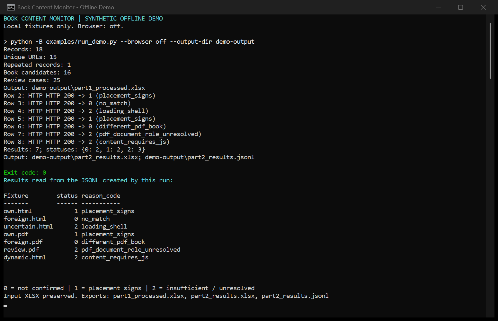
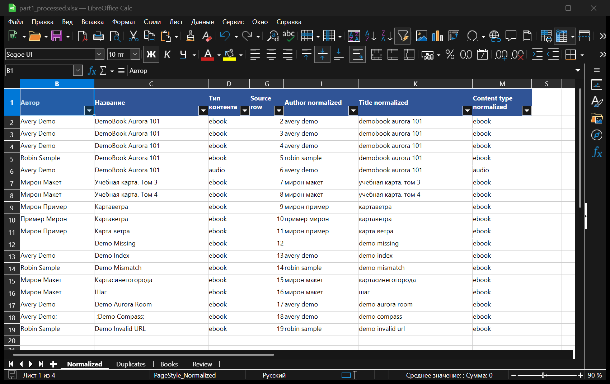
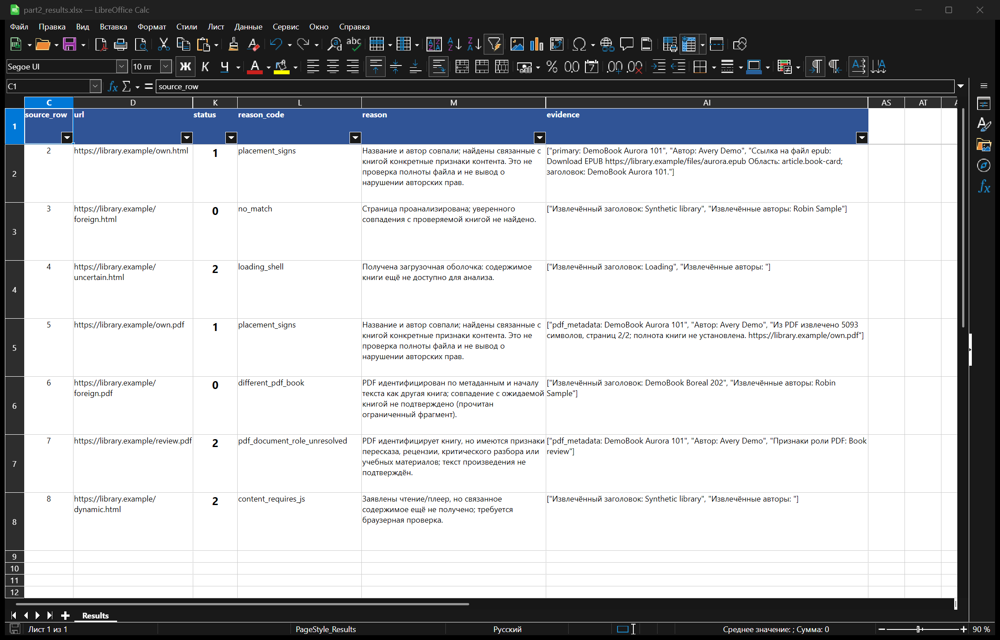

# Book Content Monitor

Python-проект для нормализации книжных реестров Excel и проверки признаков размещения произведений по URL. Он сопоставляет название и автора с содержимым HTML/PDF, сохраняет исходные данные и объясняет каждое решение через `reason_code` и `evidence`.

Проект помогает разбирать повторяющиеся записи, находить противоречия в реестре и отделять подтверждённые признаки размещения от чужих книг и случаев, требующих ручной проверки. Результат — структурированные XLSX и JSONL для дальнейшего анализа.

## Какие задачи автоматизирует

- Нормализует авторов, названия, типы контента и URL, сохраняя исходные ячейки и номера строк.
- Группирует полные дубликаты, повторяющиеся URL и кандидатов в одну книгу.
- Формирует очередь `Review` с причинами неоднозначности и указанием необходимых данных.
- Проверяет страницы относительно ожидаемой книги из каталога.
- Экспортирует решение вместе с идентификаторами, источником, причинами и доказательствами.

## Основные возможности

**Обработка реестра.** Исходные значения остаются в `Normalized` рядом с нормализованными полями. `source_row` и `book_id` связывают записи, кандидатов и результаты проверки. Результат нормализации содержит листы `Normalized`, `Duplicates`, `Books` и `Review`.

**Сопоставление содержимого.** Учитываются название, авторы, номера томов, метаданные и область страницы, к которой относится файл или текст. Ссылка на чужую книгу в рекомендациях не подтверждает размещение целевой книги.

**HTML и PDF.** Программа извлекает признаки файлов, текста для чтения и аудиоконтента, анализирует метаданные и доступный текст PDF. При необходимости использует ограниченные Range-запросы. Формат наблюдаемого контента сохраняется отдельно от формата в каталоге: аудиоверсия того же произведения также учитывается как признак размещения.

**Браузерный fallback.** В режиме `auto` Chromium подключается при признаках динамического содержимого. Сохраняются отдельные результаты HTTP- и браузерной попыток. Режим `off` работает без браузера.

| Статус | Значение |
|---|---|
| `0` | Признаки размещения целевой книги не подтверждены при достаточных данных для отрицательного решения |
| `1` | Подтверждены идентичность книги и принадлежащие ей признаки размещения |
| `2` | Данных недостаточно, проверка неполна или обнаружено существенное противоречие |

Статус `1` не доказывает полноту файла и не является выводом о нарушении авторских прав. Статус `2` — предусмотренный результат, который требует внимания человека.

## Схема работы

```text
Excel → нормализация полей и идентификаторы → проверка URL
      → извлечение HTML/PDF или DOM Chromium → сопоставление с книгой
      → статус + причина + доказательства → JSONL / XLSX
```

Компоненты разделены по ответственности:

| Модуль | Назначение |
|---|---|
| `part1.py` | Первый лист Excel: нормализация, группы дубликатов, кандидаты и Review |
| `pages.py` | HTTP, ограниченное извлечение HTML/PDF и признаков содержимого |
| `browser.py` | Необязательное обследование динамической страницы в Chromium |
| `part2.py` | Второй лист Excel: каталог и URL, сопоставление и экспорт решений |

Обе части читают исходный XLSX независимо. Экспорт `part1` не нужно передавать в `part2`: второй лист исходной таблицы служит мини-каталогом и списком проверяемых URL. Кандидаты `Books` сами по себе не считаются проверенными книгами.

## Технологии

Python, `openpyxl` для XLSX, `requests` для HTTP, Beautiful Soup для HTML, `pypdf` для PDF, необязательные Playwright и Chromium для JavaScript, `pytest` для тестов. Правила сопоставления выполняются локально; внешний AI-сервис не требуется.

## Установка зависимостей

Ниже — команды для PowerShell из корня проекта. **30 октября 2026 года чистая установка в новом окружении подтверждена** на **Windows x64, Python 3.14.3** (`CLEAN_INSTALL_VERIFIED`). Команды установки требуют доступа к сети.

Создание окружения и установка базового набора для HTTP-режима:

```powershell
python -m venv .venv
.\.venv\Scripts\python.exe -m pip install -r requirements.txt
```

Для браузерного режима и полного тестового корпуса дополнительно установите браузерные зависимости и Chromium. `requirements-browser.txt` также включает базовый набор:

```powershell
.\.venv\Scripts\python.exe -m pip install -r requirements-browser.txt
.\.venv\Scripts\python.exe -m playwright install chromium
```

Вместо устанавливаемого Playwright браузера CLI также поддерживает уже установленный совместимый браузер через `--browser-channel` или `--browser-executable`. При проверке чистой установки использовался установленный **Microsoft Edge на Chromium**.

## Запуск обеих частей

Входная таблица содержит шесть колонок: `Правообладатель`, `Автор`, `Название`, `Тип контента`, `url`, `Сайт`. Первый лист — реестр для `part1`, второй — мини-каталог и целевые URL для `part2`. Названия листов произвольны: важен порядок. Пример структуры — [synthetic_input.xlsx](examples/synthetic_input.xlsx).

В следующих командах `input.xlsx` обозначает вашу таблицу с настоящими URL.

**Часть 1 — нормализация без сетевых запросов:**

```powershell
.\.venv\Scripts\python.exe -B part1.py --input input.xlsx --output results/part1_processed.xlsx
```

**Часть 2 — проверка URL с браузерным fallback:**

```powershell
.\.venv\Scripts\python.exe -B part2.py --input input.xlsx --output-dir results/check --browser auto --delay 1 --browser-timeout 25
```

Для проверки только через HTTP замените `--browser auto` на `--browser off`. Часть 2 сохраняет `part2_results.jsonl` и `part2_results.xlsx`. Среди полей: `source_row`, `expected_book_id`, `status`, `reason_code`, `evidence`, `partial`, сведения о сопоставлении, формате и попытках загрузки.

Вместо XLSX можно передать каталог JSON со списком книг (`author`, `title`, необязательные `id` и `content_type`) и UTF-8-файл URL, по одному адресу на строку:

```powershell
.\.venv\Scripts\python.exe -B part2.py --catalog catalog.json --urls urls.txt --output-dir results/check --browser off
```

Полная справка:

```powershell
.\.venv\Scripts\python.exe -B part1.py --help
.\.venv\Scripts\python.exe -B part2.py --help
.\.venv\Scripts\python.exe -B examples/run_demo.py --help
```

## Офлайн-демонстрация

[Синтетический Excel](examples/synthetic_input.xlsx) содержит 18 строк на листе `Records` и семь сценариев на листе `Catalog`. Вымышленные авторы и книги, четыре HTML и три PDF созданы локальным [генератором входных материалов](examples/create_synthetic_assets.py).

`examples/run_demo.py` вызывает настоящие CLI обеих частей, подставляет локальные ответы вместо HTTP и блокирует непредусмотренные запросы. В браузере известные маршруты обслуживаются фикстурами, неизвестные блокируются. Адреса `library.example` здесь являются идентификаторами фикстур: запускайте их через demo-wrapper, а не напрямую через сетевой `part2.py`.

Для воспроизведения используйте отдельные каталоги, чтобы сохранить приложенные результаты:

```powershell
.\.venv\Scripts\python.exe -B examples/run_demo.py --browser off --output-dir results/demo-off
.\.venv\Scripts\python.exe -B examples/run_demo.py --browser auto --output-dir results/demo-browser
```

Режиму `auto` нужен установленный Chromium. Приложенные [part1_processed.xlsx](examples/output/part1_processed.xlsx), [part2_results.xlsx](examples/output/part2_results.xlsx) и [part2_results.jsonl](examples/output/part2_results.jsonl) получены одним настоящим запуском `off`. Это результаты классификатора, а не файлы с вручную заданными ответами.

## Реальные синтетические результаты

Ожидаемая книга каталога — **Avery Demo / DemoBook Aurora 101**, `book_id = book_4e377ef9865aaadb`.

| Сценарий | `off`: статус / reason_code | `auto`: статус / reason_code |
|---|---|---|
| Собственная HTML-книга — `own.html` | `1` / `placement_signs` | `1` / `placement_signs` |
| Чужая HTML-книга — `foreign.html` | `0` / `no_match` | `0` / `no_match` |
| Загрузочная оболочка — `uncertain.html` | `2` / `loading_shell` | `2` / `browser_not_ready` |
| Собственный PDF — `own.pdf` | `1` / `placement_signs` | `1` / `placement_signs` |
| Чужой PDF — `foreign.pdf` | `0` / `different_pdf_book` | `0` / `different_pdf_book` |
| PDF-рецензия — `review.pdf` | `2` / `pdf_document_role_unresolved` | `2` / `pdf_document_role_unresolved` |
| Динамическая HTML-карточка — `dynamic.html` | `2` / `content_requires_js` | `1` / `placement_signs` |

У PDF-рецензии распознана роль `review`, но её текст не считается текстом произведения. В режиме `auto` динамическая карточка получает подтверждение после выполнения JavaScript; неизменившаяся загрузочная оболочка остаётся неопределённой.

В приложенном экспорте собственной HTML-книге соответствуют `source_row = 2`, статус `1` и доказательство: «Ссылка на файл epub: Download EPUB https://library.example/files/aurora.epub Область: article.book-card; заголовок: DemoBook Aurora 101.» Полный список `evidence` находится в JSONL и XLSX.

Часть 1 фактически получила **18 записей, 15 уникальных URL, одну повторную запись, 16 кандидатов и 25 случаев Review**. Для каждого из семи результатов части 2 сверены все 44 поля JSONL/XLSX, включая источник, ожидаемую книгу, причины и доказательства. Исходный Excel сохранился без изменений.

## Тестирование и проверенная среда

Чистая установка публичной сборки подтверждена **30 октября 2026 года**: **1592 passed, 0 failed, 0 skipped**, все 34 тестовых модуля (`CLEAN_INSTALL_VERIFIED`). Проверка выполнена в новом окружении на Windows x64 с Python 3.14.3 и установленным Microsoft Edge на Chromium. Демонстрации `off` и `auto` прошли успешно. Предыдущий функциональный прогон от 29 октября также подтвердил сохранность исходного Excel и согласованность экспортов.

| Компонент | Проверенная версия |
|---|---|
| ОС | Windows x64 |
| Python | 3.14.3 |
| pytest | 9.0.3 |
| Playwright | 1.64.0 |
| Браузер | Установленный Microsoft Edge на Chromium |

Команда полного прогона с установленными браузерными зависимостями:

```powershell
.\.venv\Scripts\python.exe -B -m pytest -q -rs -p no:cacheprovider --basetemp=results/pytest-tmp --junitxml=results/pytest.xml tests
```

Тестовый корпус создаёт вспомогательный JSON-файл внутри тестового каталога; для сохранения исходного дерева запускайте полный корпус в отдельной копии проекта. Пропуски браузерных тестов не следует считать подтверждением работы браузера.

В репозитории есть [конфигурация GitHub Actions](.github/workflows/tests.yml). Указанные 1592 passed относятся к локальной проверке чистой установки. **Удалённый GitHub Actions CI пока не проверен.**

## Ограничения

- Проверяется наличие обоснованных признаков размещения, а не полнота книги или правовой статус публикации.
- Точность на произвольных сайтах не гарантируется: структура HTML, авторские роли, противоречивые метаданные и сложные JavaScript-страницы могут требовать ручной проверки.
- Нет OCR для сканированных PDF. Извлечение PDF, HTTP и работа браузера ограничены ресурсными лимитами и таймаутами; `partial` отражает неполное обследование документа.
- CAPTCHA, авторизация и защита сайтов не обходятся. Сетевые ошибки и существенная неопределённость сохраняются с причинами.
- Текущий CLI обрабатывает URL последовательно. Очередь заданий, PostgreSQL и распределённые воркеры описаны только как [план масштабирования](docs/scaling.md).

Подробнее: [правила принятия решений](docs/invariants.md) и [происхождение синтетических материалов](docs/data-provenance.md).

## Скриншоты

Реальные снимки локального терминала и побайтовых временных копий приложенных XLSX, открытых в LibreOffice Calc. Для читаемости в Calc настроены ширина и видимость колонок; значения не редактировались, сохранённые экспорты не перезаписывались.

**Офлайн-демонстрация в терминале.** Новый запуск на тех же синтетических входах с выводом во временный каталог; статусы совпадают с приложенным экспортом `off`.



**До и после нормализации.** Лист `Normalized` настоящего `part1_processed.xlsx`: исходные автор, название и тип слева; нормализованные поля справа; между ними — исходный номер строки.



**Результаты проверки.** Настоящий `part2_results.xlsx` из приложенного запуска `off`: статусы `0/1/2`, причины и доказательства для семи сценариев.


